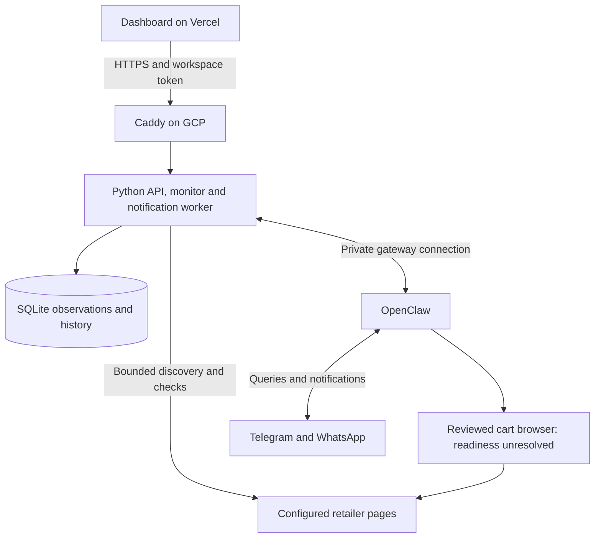

# RotorWatch

**Track drone and robotics parts, understand what changed, and check the evidence before you buy.**

RotorWatch is a private sourcing workspace for drone builders, robotics students
and small project teams in India. It monitors configured retailer pages, stores
stock and price observations, and brings watchlists, product history, chat and
messaging alerts into one dashboard.

Instead of treating a saved price as a live quote, RotorWatch shows when it was
observed. Product questions can trigger fresh checks; unavailable pages and
uncertain variants remain explicitly unverified.

[Dashboard](https://rotorwatch-swart.vercel.app) ·
[Architecture and flowcharts](docs/ARCHITECTURE.md) ·
[Editable Miro board](https://miro.com/app/board/uXjVEZX2kzM=/) ·
[Three-minute presentation script](docs/PRESENTATION_3_MINUTES.md)

The dashboard opens with labelled synthetic data until connected to a private
backend. Access to the owner's live workspace requires its API token. A hosted
frontend does not provide a public account or run the monitoring service.

## What you can do

| Task | RotorWatch behavior |
|---|---|
| Track a part | Add an exact retailer product URL or a name-based watch rule |
| Explore products | Filter by retailer, search terms, stock, price and watch state; export CSV |
| Ask about price or stock | Attempt bounded fresh checks, then show product IDs, links and observation times |
| Review recent changes | See meaningful recorded events from the last 24 hours; initial checks are excluded |
| Receive alerts | Queue watched-product changes for configured Telegram and WhatsApp destinations |
| Query from messaging apps | Use the OpenClaw plugin to call the same backend chat handler |
| Prepare a purchase | Save a review of an exact product, quantity, variant and page price before explicit Add-to-cart confirmation |

**Current limitation:** browser preparation is failing on the owner's VM. The
review/confirm cart flow exists in code and fixture tests, but a successful live
retailer cart update has not been verified. Retailer account login and browser
readiness are prerequisites; no checkout or payment is automated.

## A typical workflow

1. Add a product URL or a name such as `Pixhawk 6X` to your watchlist.
2. Let the scheduled monitor discover/check configured listings, or request a check.
3. Inspect the returned retailer, stock state, price and observation history.
4. Ask a fresh question or review recorded changes; enable the channels you want.
5. If preparing a cart, choose the exact returned product ID and review the
   current page details. Confirm only after preparation succeeds.

Example chat requests:

```text
what is the latest price of Raspberry Pi 5 from thinkrobotics
is Pixhawk 6X available on any monitored website?
what changed recently?
/watch https://thinkrobotics.com/products/raspberry-pi-5?variant=47731530432829
```

A cart request uses `add to cart P<number> quantity 1`; the returned review may
then request `confirm cart C<number>`. Product and review numbers come from your
own database. A chat confirmation must refer to a review prepared in that same
backend chat session and expires after five minutes.

## How it works



One Python `serve` process owns the API, scheduler, ad hoc check queue and
notification worker. OpenClaw is a separate gateway container. The scraper's
optional Playwright fallback and OpenClaw's cart browser are separate paths.
See [all four detailed flows](docs/ARCHITECTURE.md).

### Retailer checks and freshness

The source registry includes **Robu.in, ThinkRobotics, Zbotic and Evelta**, covering
WooCommerce, Shopify and BigCommerce listings. This is bounded discovery across
configured sites, not an exhaustive inventory search. Adding another retailer
requires administrator source configuration and extraction validation.

The monitor tries structured product data and scoped HTML extraction, with
optional headless rendering and conservative model classification when evidence
is ambiguous. Exact Shopify variant IDs are preserved. Robots rules, pacing,
URL/redirect allowlists and request limits apply. Blocks, conflicts and unresolved
variants remain unknown rather than becoming guessed stock claims.

- The supplied `.env.example` schedules checks every **900 seconds**; scans also
  take time to complete. The UI polls the API every **five seconds**.
- Supported price/stock questions attempt fresh checks for up to three existing
  matches and bounded discovery when needed. Busy or incomplete searches may be
  queued for background work, with the limitation reported to the user.
- Prices are stored as integer minor units and retain their own observation
  time. A saved price is labelled when the latest check did not verify it.
- Human-facing times use **Asia/Kolkata (IST)**. Database and API times remain UTC.
- Meaningful changes produce events. Initial observations establish a quiet
  baseline; an unchanged check timestamp does not create a change alert.

### AI and notifications

Supported shopping requests and commands have deterministic handlers. A small
OpenAI-compatible model is optional for richer intent interpretation, ambiguous
page classification and short event wording. Database records supply the product
facts. Missing keys, provider failures and exhausted call budgets have fallbacks;
model outputs are not arbitrary SQL or executable browser scripts.

Notifications use a durable SQLite outbox, deduplication keys and retries. In the
combined setup, OpenClaw owns Telegram and QR-linked WhatsApp. The optional direct
Meta WhatsApp transport is outbound-only. External network ambiguity means
exactly-once delivery is not guaranteed.

## Run the local demo

Requires **Python 3.11+**. Clone the repository and run from its root:

```bash
git clone https://github.com/VIKSIT-GARG/rotorwatch.git
cd rotorwatch
python3 scripts/bootstrap.py
.venv/bin/python -m drone_assistant serve --demo
```

Open **http://127.0.0.1:8000**. On Windows, use `python` for bootstrap and
`.venv\Scripts\python.exe` for the second command. Demo mode uses an in-memory
database and synthetic observations, with no retailer requests, model calls or
external messages. Bootstrap installs dependencies and requires internet access.

For a portable UI demo:

```bash
node scripts/build-preview.mjs
```

Open `dist/rotorwatch-dashboard.html`. This view is also synthetic until connected
to an authenticated backend; a local-file origin may be restricted by browser CORS.

## Deploy the live system

| Component | Runtime | Configuration |
|---|---|---|
| Dashboard | Vercel static hosting | Deploy repository `web/` directory |
| API, scheduler and scraper | One GCP VM / `assistant` container | Private VM `.env`, `compose.yaml` |
| Messaging and retailer browser | `openclaw` container | `compose.openclaw.yaml`, gateway state |
| HTTPS proxy | `caddy` container | `compose.https.yaml`, `API_DOMAIN` |
| Persistent state | Docker named volumes | `assistant-data`, `openclaw-state`, Caddy volumes |
| Source checks | GitHub Actions | Tests and builds; no GCP auto-deployment workflow |

### Vercel: choose the root for the source you upload

| Deployment source | Root Directory |
|---|---|
| This complete GitHub repository | `web` |
| A standalone folder already containing `index.html` and `app.js` | `./` |

Use **Other** as the framework, empty build/install command overrides and output
directory **`.`**. `web/vercel.json` contains the buildless settings and headers.
Do not apply `web` to a standalone frontend upload: that folder does not exist
inside it. Connect the intended repository to the existing Vercel project if
you want Git-triggered deployments while retaining its production domain.

### Backend connection and private configuration

Follow [GCP deployment](deploy/GCP.md) and [OpenClaw setup](deploy/OPENCLAW.md) for a
new installation. Copy `.env.example` only when creating a new private `.env`;
preserve the existing file and named volumes during updates. Generate separate
random workspace and gateway tokens and configure the desired channel accounts.

| Setting | Purpose |
|---|---|
| `API_TOKEN` | Private workspace authentication secret, at least 24 characters |
| `CORS_ORIGINS` | Exact allowed frontend origins, without trailing slashes |
| `API_DOMAIN` | Hostname pointing at the VM for the Caddy HTTPS overlay |
| `CHECK_INTERVAL_SECONDS` | Monitoring interval; example is 900 seconds |
| `LLM_API_KEY`, `LLM_BASE_URL`, `LLM_MODEL` | Optional model provider configuration |
| `LLM_DAILY_CALL_LIMIT` | Shared cap on model calls |
| `TELEGRAM_BOT_TOKEN`, `TELEGRAM_ALLOWED_CHAT_IDS` | Bot credentials and private destination allowlist |
| `WHATSAPP_TO` | Allowed WhatsApp destination for the combined setup |
| `OPENCLAW_GATEWAY_TOKEN`, `OPENCLAW_URL` | Separate private gateway authentication and origin |

In the dashboard, choose **Connect backend**, enter your HTTPS backend URL and
workspace `API_TOKEN`. The browser uses `X-RotorWatch-Token`; internal tools may
use Bearer authentication. The workspace token is held in that browser tab's
session storage. This is a single-operator workspace, not a multi-user login.
Provider keys, gateway tokens and account sessions stay on the backend.

The existing owner's HTTPS backend is
`https://rotorwatch-35-244-35-69.sslip.io`. Other installations should use their own
hostname and credentials. Vercel preview URLs require their own explicit CORS
origins if they need backend access.

Initialize the gateway and link the messaging accounts **before** the first
combined stack start. For an already configured deployment, the stack is:

```bash
docker compose -f compose.yaml -f compose.openclaw.yaml -f compose.https.yaml up -d --build
```

Do not run this merely to publish README changes. Keep the API and gateway ports
private; public HTTPS goes through Caddy. Detached services continue after SSH
or Cloud Shell closes while the VM remains running. Git pushes do not update the
GCP backend automatically. Preserve the Compose project name and volumes on
releases; `docker compose down -v` deletes persistent data.

## Repository guide

| Path | Responsibility |
|---|---|
| `web/` | Static dashboard, browser requests and product views |
| `src/drone_assistant/api.py`, `service.py` | API, authentication and worker lifecycle |
| `monitor.py`, `fetching.py`, `extraction.py`, `sources.py` | Retailer discovery, requests and extraction |
| `storage.py`, `app_store.py` | SQLite catalog, observations, events, reviews and outbox |
| `shopping.py`, `web_chat.py`, `chat.py` | Product questions and grounded responses |
| `cart.py`, `openclaw.py` | Reviewed browser actions and private gateway adapter |
| `integrations/openclaw/` | Channel tools and gateway setup |
| `deploy/` | GCP, frontend, messaging, shopping and browser guides |
| `tests/`, `.github/workflows/ci.yml` | Python, frontend and integration checks |

Python module names in the table are relative to `src/drone_assistant/`.

## Verification and project status

The reviewed source snapshot passed **90 Python tests** with one optional browser
integration skipped, and **9 JavaScript/DOM tests** in the local environment.
These tests cover parsing, authentication/CORS, monitoring state, chat, outbox
behavior and fixture-based cart safeguards. They do not establish live retailer
coverage, model/provider authentication or a successful retailer cart update.

```bash
python -m pip install -e '.[dev]'
ruff check src tests scripts/bootstrap.py
ruff format --check src tests scripts/bootstrap.py
pytest -q
npm ci
npm run test:web
```

CI includes Python 3.11–3.13, frontend tests, Docker build/demo and a check against
OpenClaw 2026.10.3. Configured CI jobs are not a claim that the current remote run
has passed. The owner reported working replies on both messaging channels;
backend health and CORS checks were observed during setup. Browser preparation
remains unresolved. See [review notes](docs/PROJECT_REVIEW.md),
[verification history](docs/VERIFICATION.md) and
[browser troubleshooting](deploy/BROWSER_TROUBLESHOOTING.md).

Current scope excludes multi-user authentication, a full drone-part compatibility
engine, exhaustive retailer coverage, CAPTCHA bypass, remote desktop login and
automatic checkout/payment. Prices and availability can change after observation.

## Further reading

- [Four architecture and user-flow diagrams](docs/ARCHITECTURE.md)
- [Three-minute presentation script](docs/PRESENTATION_3_MINUTES.md)
- [Deployment connections and GitHub walkthrough](docs/CONNECTIONS_AND_GITHUB.md)
- [Frontend deployment](deploy/FRONTEND.md)
- [Prices and reviewed cart requests](deploy/SHOPPING.md)
- [Source snapshot provenance](docs/REPOSITORY_SNAPSHOT.md)
