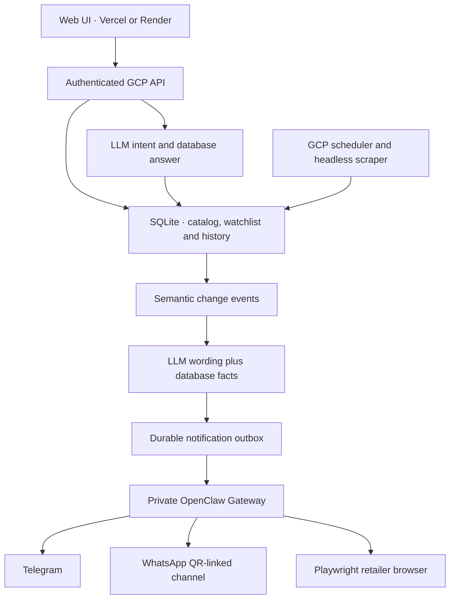

# RotorWatch — Drone Parts Assistant

An always-on GCP scraper and database, OpenClaw for WhatsApp + Telegram and retailer browser actions, with a separate web dashboard for Indian drone builders. It tracks Robu.in, ThinkRobotics, Zbotic and Evelta. The web interface can be hosted on Vercel or Render.

## Deployment connections and GitHub walkthrough

Read [the complete connection guide](docs/CONNECTIONS_AND_GITHUB.md) for the current
GCP/Vercel layout, GitHub upload commands, Vercel project settings, credentials,
update ownership and the unresolved browser preparation issue.

## Repository snapshot

Curated on 16 October 2026 from the owner's current GCP backend and Cloud Shell
frontend backups. Backend source is in `src/drone_assistant/`; the shared frontend
is in `web/`. The frontend application files in both supplied backups matched.
The standalone frontend's Vercel configuration is retained in `web/vercel.json`.
See [the snapshot notes](docs/REPOSITORY_SNAPSHOT.md) for provenance and checks.

For a GitHub-connected Vercel deployment, set **Root Directory** to **`web`**.
The Python service, database, scheduler and OpenClaw stay on GCP. Credentials,
databases, browser sessions and Docker volumes are deliberately not part of this
repository. Preserve the existing VM `.env` and volumes when deploying updates.

## Open the interface

Requires Python 3.11 or newer. From the extracted project:

```bash
python3 scripts/bootstrap.py
.venv/bin/python -m drone_assistant serve --demo
```

Open **http://127.0.0.1:8000**. On Windows, use `python` for bootstrap and `.venv\Scripts\python.exe` for the second command. The demo uses synthetic data, an in-memory database, and no retailer requests, LLM calls or external messages.

The UI includes:

- Overview with availability counts, recorded history and recent changes.
- Live watchlist and product explorer: search, retailer/stock/budget filters, watch/unwatch, product observations, retailer links and CSV export.
- Chat: grounded price/stock checks, reviewed cart requests, recent recorded changes and bounded database queries. A model is optional for supported commands and shopping requests.
- Alert activity and delivery queue, with channel and change-type preferences.
- OpenClaw purchase browser: inspect the exact product, review price/variant/quantity, explicitly confirm Add to cart. Checkout/payment stays manual.
- OpenClaw plugin for inbound WhatsApp and Telegram database queries.

For a portable single-file demo, run `node scripts/build-preview.mjs` and open `dist/rotorwatch-dashboard.html`. Frontend development dependencies are only needed for tests, not to run or deploy the dashboard.

## Architecture



One Python `serve` process runs the API, monitoring scheduler and notification worker. In the combined setup a separate OpenClaw Gateway owns both channels and its managed browser. The direct transport retains an optional Python Telegram poller. It remains online 24/7. Retailers are checked at `CHECK_INTERVAL_SECONDS` (the supplied `.env.example` uses 900 seconds). The UI polls the API every five seconds. This is periodic observation, not a direct retailer inventory stream.

Stock, price, extracted details, verification failures and new matching listings produce change events. An unchanged check timestamp alone does not. Initial availability establishes a quiet baseline. Restocks and sold-out changes both appear in the v2 service. Notifications respect watched products and preferences.

Each event is summarized once. The small model selects a short validated introduction; canonical product, stock, price, timestamp and URL facts are then appended from the database. Missing keys, provider errors or exhausted budgets fall back to a deterministic message. Deliveries are deduplicated per event/channel/destination and retried through a leased outbox. Network ambiguity can still produce duplicate external messages; exactly-once delivery across third-party APIs is not guaranteed.

Human-readable observation and chat timestamps use **Asia/Kolkata (IST)**;
API and database timestamps remain UTC. Recent activity covers meaningful recorded
changes in the last 24 hours and excludes initial checks. A fresh price/stock
question attempts a retailer recheck; historical observations are not live stock
guarantees.

## WhatsApp + Telegram + OpenClaw setup (v0.3)

Use [deploy/OPENCLAW.md](deploy/OPENCLAW.md) for the combined setup. The custom
plugin was loaded in the actual OpenClaw 2026.10.3 runtime and the generated
configuration validated. Both channel routes and cart logic are implemented;
live pairing/delivery and retailer sessions still require your accounts.

```bash
docker compose -f compose.yaml -f compose.openclaw.yaml up -d --build
```

Run the initialization and WhatsApp QR-link commands in that guide **before**
starting the stack for the first time. The dashboard has **Send test to both**
and a reviewed browser Add-to-cart flow. No automatic checkout is implemented.

## Run against real retailers

```bash
cp .env.example .env
python3 -c 'import secrets; print(secrets.token_urlsafe(32))'
```

Put the generated secret in `API_TOKEN`; add the desired provider credentials in `.env`. Then run:

```bash
python3 scripts/bootstrap.py --browser
.venv/bin/python -m drone_assistant serve
```

Open the same local URL and use **Connect backend** with `http://127.0.0.1:8000` and the token. Bind remotely only behind HTTPS.

| Backend setting | Purpose |
|---|---|
| `API_TOKEN` | Required private workspace secret, at least 24 characters |
| `CORS_ORIGINS` | Exact frontend origins allowed to connect |
| `CHECK_INTERVAL_SECONDS` | Minimum 60; 900 gives a 15-minute scan interval |
| `LLM_API_KEY`, `LLM_BASE_URL`, `LLM_MODEL` | OpenAI-compatible small-model provider |
| `LLM_DAILY_CALL_LIMIT` | Shared cap for classification, chat and messages |
| `TELEGRAM_BOT_TOKEN`, `TELEGRAM_ALLOWED_CHAT_IDS` | Optional private Telegram delivery/chat |
| `NOTIFICATION_TRANSPORT=openclaw` | Both channels through OpenClaw (recommended combined setup) |
| `OPENCLAW_GATEWAY_TOKEN`, `OPENCLAW_URL` | Private gateway connection; secret stays off the frontend |
| `WHATSAPP_TO` | Your QR-linked WhatsApp destination |
| Other `WHATSAPP_*` | Used only by the alternative direct Meta transport |

Create a Telegram bot using BotFather, send it `/start`, and use `python -m drone_assistant telegram-id` after adding its token to find your private chat ID. Only configured private IDs are accepted.

In the default OpenClaw mode WhatsApp uses QR linking, and Telegram uses your bot token. Both support inbound database chat through the RotorWatch plugin. For the alternative `NOTIFICATION_TRANSPORT=direct` mode, WhatsApp requires Meta business/Cloud API setup, an opted-in recipient and an approved template with one text body parameter. Set phone-number ID, destination (international digits only), token, template name/language, and a supported Graph version from your Meta console. Enable WhatsApp in dashboard alert settings after configuration. API acceptance is recorded as `sent`; the direct Meta transport does not ingest delivery/read webhooks or incoming WhatsApp chat.

## Deploy

- **OpenClaw:** [deploy/OPENCLAW.md](deploy/OPENCLAW.md) — both channels, plugin and retailer browser.
- **GCP:** [deploy/GCP.md](deploy/GCP.md) — Compute Engine, persistent volume, private API token, HTTPS/Caddy, backups and verification.
- **Frontend:** [deploy/FRONTEND.md](deploy/FRONTEND.md) — Vercel/Render configuration and connecting the UI to the GCP API.

```bash
docker compose -f compose.yaml -f compose.openclaw.yaml up -d --build
```

The Python image includes Chromium and runs as a non-root user. SQLite is stored in the `assistant-data` named volume. Port 8000 is bound to VM loopback by default. Use the HTTPS overlay for a hosted frontend. Keep **one process/replica**; do not run the legacy `run` command alongside `serve` against the same database.

## Scraping and database behavior

HTTPS URLs/redirects and browser resources are restricted to configured retailer hosts; private/local/metadata addresses are rejected. The fetcher respects robots rules and pacing, bounds response sizes, and retains unknown status on blocks, conflicting evidence and unresolved product variants. No CAPTCHA solving or access-control bypass is included.

The pipeline tries HTTP/structured data first, then optional headless Chromium, then conservative small-model classification of ambiguous page text. ThinkRobotics Shopify variant IDs are retained. Prices use integer paise. Prefer exact SKU/variant URLs; general listing prices may not represent your chosen variant.

Seed watches include Pi 5, compatible HAT discovery, Pixhawk 6X and flight controllers. Name watches create bounded lexical discovery rules. Add products through the UI or `/watch <name/URL/P1>`. Add retailers through the administrator source configuration (`SOURCES_FILE`), with fixtures and host validation before enabling them.

SQLite WAL stores products, observations, watches, rules, exclusions, chat, events, preferences, purchase reviews, LLM cache/budget and the outbox. Existing v1/v2 databases migrate automatically; old unsent raw availability alerts are superseded during migration to avoid duplicate v2 summaries. Back up before upgrading. The ad hoc check queue is in memory; periodic checks, data and notification retries survive restarts.

## Commands and backup

```bash
python -m drone_assistant check --no-discovery
python -m drone_assistant chat 'find Raspberry Pi 5 in stock under 10000'
python -m drone_assistant demo
python -m drone_assistant health
docker compose exec assistant python -m drone_assistant backup /app/data/backup.sqlite3
docker cp "$(docker compose ps -q assistant)":/app/data/backup.sqlite3 ./backup.sqlite3
```

The original `run` command remains a Telegram-only compatibility mode. Use `serve` for the complete web/change-event/WhatsApp system. Restore backups only with the service stopped. `docker compose down` preserves data; `down -v` deletes it.

## Verification and limits

```bash
.venv/bin/python -m pip install -e '.[dev]'
.venv/bin/ruff check src tests scripts/bootstrap.py
.venv/bin/ruff format --check src tests scripts/bootstrap.py
.venv/bin/pytest -q
npm ci
npm run test:web
```

API tests cover authentication/CORS, mutations, history, database chat, schema upgrades, semantic events, channel routing, retries and honest purchase states. DOM tests exercise navigation, filters, watch toggles, demo updates, chat and purchase reviews. CI includes Python 3.11–3.13, frontend tests and Docker. See [docs/VERIFICATION.md](docs/VERIFICATION.md) for actual executed checks and [docs/DEMO.md](docs/DEMO.md) for the recording checklist.

This is a single-operator prototype. It has no multi-user login, arbitrary SQL execution, full compatibility engine, guaranteed complete retailer coverage, budget-conditioned watch rules or automatic checkout. OpenClaw channel pairing and retailer cart behavior need live verification on your deployment. Inbound WhatsApp chat is available through OpenClaw; the direct Meta transport is outbound-only. LLM answers can still be imperfect: product cards and observation timestamps provide the underlying evidence. External credentials and deployment configuration are needed for real LLM inference and notifications.

Primary references: [FastAPI](https://fastapi.tiangolo.com/), [Telegram](https://core.telegram.org/bots/api), [WhatsApp](https://business.whatsapp.com/developers/developer-hub), [Shopify](https://shopify.dev/docs/api/ajax/reference/product), [Playwright](https://playwright.dev/python/docs/docker), [GCP](https://cloud.google.com/compute/docs/instances/create-start-instance).
