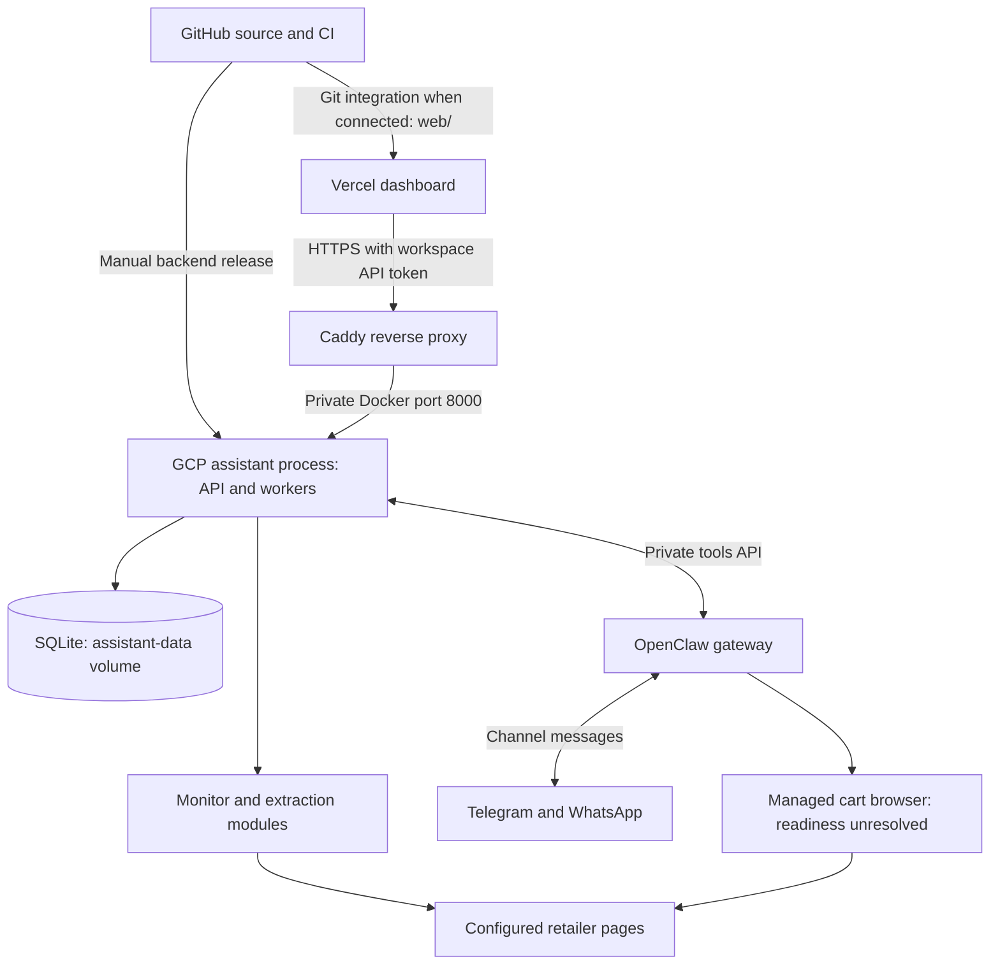
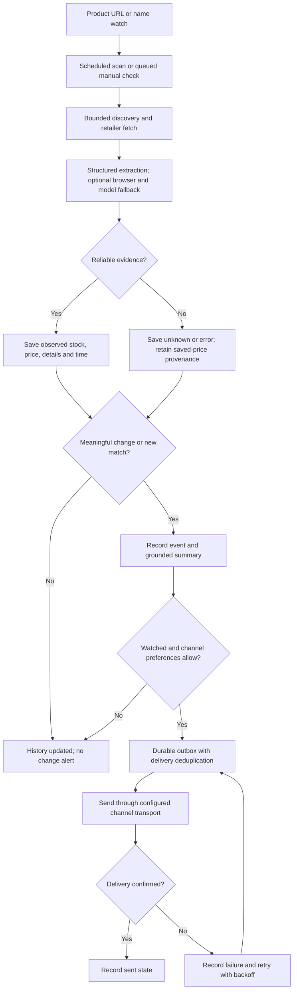
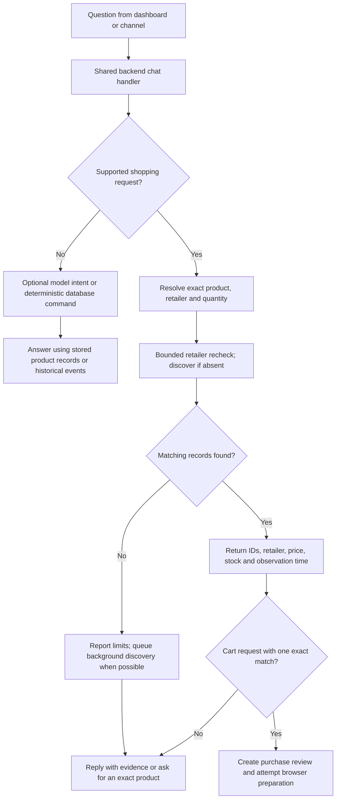
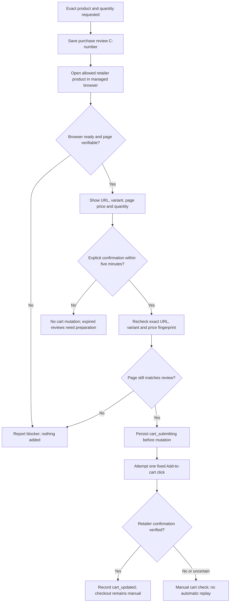

# RotorWatch architecture and flows

[Open the editable Miro flowcharts](https://miro.com/app/board/uXjVEZX2kzM=/).
These diagrams describe the reviewed source, not a guarantee that every external
service or retailer is currently reachable. The managed cart browser remains an
unresolved deployment issue as of 16 October 2026.

## 1. Deployment and component boundaries

`Service` owns the monitoring, notification and heartbeat tasks inside one Python
process. OpenClaw is a separate container; Caddy terminates HTTPS. The fetcher's
optional Chromium fallback is separate from OpenClaw's managed cart browser.
GitHub CI tests source; no workflow in this repository automatically deploys the
GCP backend. A Git-connected Vercel project can deploy `web/` automatically.

## 2. Monitoring and notification lifecycle

The example interval is 900 seconds; the dashboard polling interval is five
seconds. Neither creates a real-time inventory feed. Initial catalog observations
establish a quiet baseline, and unchanged checks do not create change alerts.
Outbox deduplication does not guarantee exactly-once delivery across external
providers. Discovery coverage is bounded and site blocks remain visible.

## 3. Chat, latest prices and stock

Up to three existing matches are rechecked synchronously. A timeout or lock
conflict is reported as unverified saved data; no match is not evidence that a
product is sold out. Prices have their own observation timestamps and stale-price
labels. Human-facing timestamps use IST; storage and API timestamps remain UTC.
Recent activity shows meaningful events from the last 24 hours, not live quotes.
Model calls are optional and budgeted; the model does not supply arbitrary SQL or
invent cart confirmations.

## 4. Reviewed Add-to-cart

For chat, the review must have been prepared in the same backend chat session.
The dashboard has its own explicit confirmation endpoint. Browser launch, login,
CAPTCHA, unresolved variants and changed page controls can block preparation.
The flow is implemented and fixture-tested, but the current live deployment has
not demonstrated a successful cart mutation. The headless profile is not a
remote desktop; signing into a laptop browser does not sign into the VM profile.

## Where to inspect the implementation

| Concern | Source |
|---|---|
| API auth, CORS and public health route | `src/drone_assistant/api.py` |
| Scheduler, queue and worker ownership | `src/drone_assistant/service.py` |
| Discovery and extraction orchestration | `src/drone_assistant/monitor.py` |
| URL policy, robots checks and browser fallback | `src/drone_assistant/fetching.py`, `sources.py` |
| Products, observations and events | `src/drone_assistant/storage.py`, `app_store.py` |
| Chat and fresh shopping checks | `src/drone_assistant/web_chat.py`, `shopping.py` |
| Notification outbox and provider calls | `src/drone_assistant/notifications.py`, `openclaw.py` |
| Reviewed browser action | `src/drone_assistant/cart.py` |
| OpenClaw channel tool bridge | `integrations/openclaw/` |
| Frontend and request handling | `web/app.js`, `web/core.js` |

See [deployment connections](CONNECTIONS_AND_GITHUB.md) and
[browser diagnostics](../deploy/BROWSER_TROUBLESHOOTING.md) for operations.
