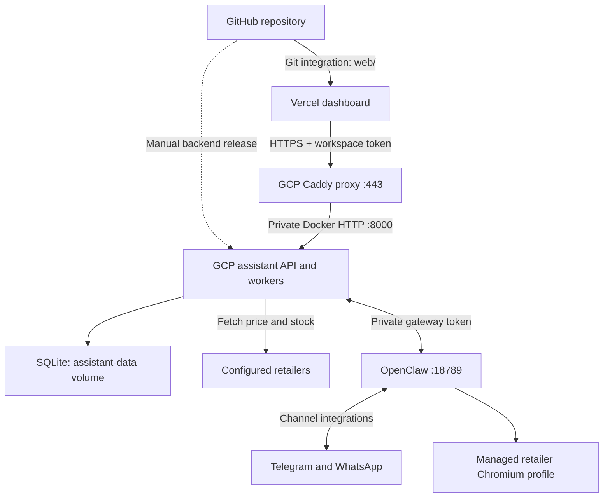

# GitHub, Vercel and GCP — owner's walkthrough

This repository is the current source snapshot. It is ready to push, but browser
preparation is a known unresolved runtime issue. Source in GitHub does not by
itself connect or redeploy either hosting provider.

## 1. What runs where



The dashed backend release path is manual; no GCP deployment workflow is installed.
The GitHub Actions workflow tests code. Vercel Git integration deploys the frontend
when connected; a green GitHub test job alone does not deploy the VM.

| Component | Current location or configuration | Repository source |
|---|---|---|
| Frontend | https://rotorwatch-swart.vercel.app | `web/` |
| Vercel project | `rotorwatch`, scope `viksit427-1349` | `web/vercel.json` |
| HTTPS backend | https://rotorwatch-35-244-35-69.sslip.io | `deploy/Caddyfile`, `compose.https.yaml` |
| GCP project | `project-1d4cc719-9ffd-484f-b2e` | Runtime infrastructure |
| GCP VM | `drone-parts-assistant`, `asia-south1-a` | `deploy/GCP.md` |
| VM source folder | `/opt/drone-parts-assistant` | Repository root contents |
| API and scheduler | `assistant` container, loopback port 8000 | `src/drone_assistant/`, `compose.yaml` |
| SQLite | `assistant-data` Docker volume | Schema and migrations in Python source |
| Messaging and browser | `openclaw` container, loopback port 18789 | `compose.openclaw.yaml`, `integrations/openclaw/` |
| Channel/browser state | `openclaw-state` Docker volume | Not included in GitHub |
| TLS certificates | `caddy-data` Docker volume | Not included in GitHub |
| Runtime credentials | Private VM `.env` and OpenClaw state | Blank `.env.example` only |
| CI | Tests on push and pull request | `.github/workflows/ci.yml` |

## 2. Push the extracted project to GitHub

Extract `rotorwatch-github-ready.zip`, open the `rotorwatch` folder in your editor,
and open a terminal in that folder. README.md, web/, src/ and .github/ should be
direct children. Do not put an extra rotorwatch/ folder inside the repository.

Create an empty GitHub repository in your account. Leave its README, license and
.gitignore initialization options unchecked because this package has its own
files. Use its actual HTTPS URL in the command below.

```bash
git init
git branch -M main
git add .
git status --short
git commit -m "Import current RotorWatch GCP backend and Vercel frontend"
git remote add origin https://github.com/YOUR_USERNAME/YOUR_REPOSITORY.git
git push -u origin main
```

Git must be installed and authenticated to your GitHub account. Do not enter
API tokens into source files. Use the GitHub sign-in method offered by your Git
credential helper. These commands assume a new empty repository; for an existing
repository, preserve its history and integrate the snapshot in a normal commit.
Do not force-push it.

The package excludes private runtime state; .gitignore also excludes .env,
.vercel, dependencies, caches, databases, keys and backups. The .env.example with
blank secrets should appear in GitHub. On GitHub, verify README.md is at the root,
web/ and src/ exist, and the Actions tab sees the Verify workflow.

## 3. Connect the existing Vercel project

Use the existing `rotorwatch` project to keep the production URL. You do not need
a second project or a new backend VM.

1. Open Vercel, choose scope `viksit427-1349`, and open project `rotorwatch`.
2. In Settings → Build and Deployment, set the values in the table below and save.
3. In Settings → Git, connect the GitHub repository you just pushed. Authorize
   the Vercel GitHub integration for that repository if prompted.
4. Set or confirm the production branch is `main`.
5. Deploy the connected repository's `main` commit. If connecting already created
   that deployment, wait for it. Otherwise use Create Deployment with `main` as
   the Git reference. A redeploy of an old CLI upload may still use that old
   uploaded source, so check that the new deployment shows your GitHub commit.
6. Wait for Ready and confirm the production domain remains
   `rotorwatch-swart.vercel.app`.

| Vercel setting | Value |
|---|---|
| Root Directory | `web` |
| Framework Preset | Other |
| Build Command | Empty override |
| Install Command | Empty override |
| Output Directory | `.` |
| Production branch | `main` |
| Provider/API secrets in frontend environment | None required |

The old standalone frontend had files at its deployment root. This full repo
has them in web/, which is why the Root Directory changes. web/vercel.json
already contains the buildless settings and response headers. Existing protection
settings are separate from the workspace token; Git linking does not change them.

Once linked, pushes to the production branch trigger Vercel production builds;
other branches create preview deployments according to project settings. Preview
origins need separate explicit backend CORS entries if you want to use them.

## 4. Connect the dashboard to the existing backend

Open the production dashboard and choose Connect backend:

- Backend URL: `https://rotorwatch-35-244-35-69.sslip.io`
- Workspace API token: the existing private `API_TOKEN` from the running VM.

The browser supplies X-RotorWatch-Token; the API also accepts Bearer authentication
for internal tools. The backend checks the secret, and CORS permits exact frontend
origins. Keep these private VM settings:

```dotenv
API_DOMAIN=rotorwatch-35-244-35-69.sslip.io
CORS_ORIGINS=https://rotorwatch-swart.vercel.app
```

If there are already additional allowed origins, retain them as a comma-separated
list. Never copy the real API token into README, web/ or Vercel build variables.
As long as this production origin and backend URL stay the same, GitHub linking
requires no token rotation, DNS change, firewall change or new CORS setting.

The current tab keeps its workspace connection in sessionStorage. A fresh tab
can require connection again. Vercel Authentication, if enabled, is independent.

## 5. Understand updates and uptime

- Frontend change: edit web/, commit and push; linked Vercel deploys it.
- Backend change: edit Python/integration/deployment files, test and push, then
  explicitly release that code to the VM. GitHub and Vercel do not do this step.
- A frontend asset change should also reach the VM on its next backend release
  if you want the VM-served interface to match Vercel.
- Preserve the VM .env, Docker Compose project name and named volumes on updates.
  Replacing the code in the same /opt/drone-parts-assistant folder avoids silently
  choosing a new Compose project/empty volumes.
- Keep the VM running. Closing Cloud Shell, SSH, your laptop or Vercel's dashboard
  does not stop detached containers. restart: unless-stopped is already configured.
- Do not run docker compose down -v as an update step; it deletes volumes.

The monitoring interval defaults to 900 seconds. Product price/stock questions
attempt fresh bounded checks. Database history remains historical evidence, and
human-facing times use IST while API/database timestamps stay UTC.

## 6. Current browser failure

The owner diagnostic returned browser status HTTP 200 but running=false,
cdpReady=false, noSandbox=false, chosenBrowser=null. Opening a page returned HTTP
500 with "tool execution failed". This confirms launch/navigation failure but
not its cause. noSandbox=false alone is not proof of a sandbox failure, and
chosenBrowser=null while stopped is not proof that Chromium is absent.

Use the direct browser startup command in deploy/BROWSER_TROUBLESHOOTING.md to
obtain the underlying error. Keep checkout/manual payment out of this test.
The GitHub snapshot is ready even though this deployment issue remains open.

## Official platform references

- https://vercel.com/docs/git/vercel-for-github
- https://vercel.com/docs/builds/configure-a-build
- https://docs.openclaw.ai/cli/browser
